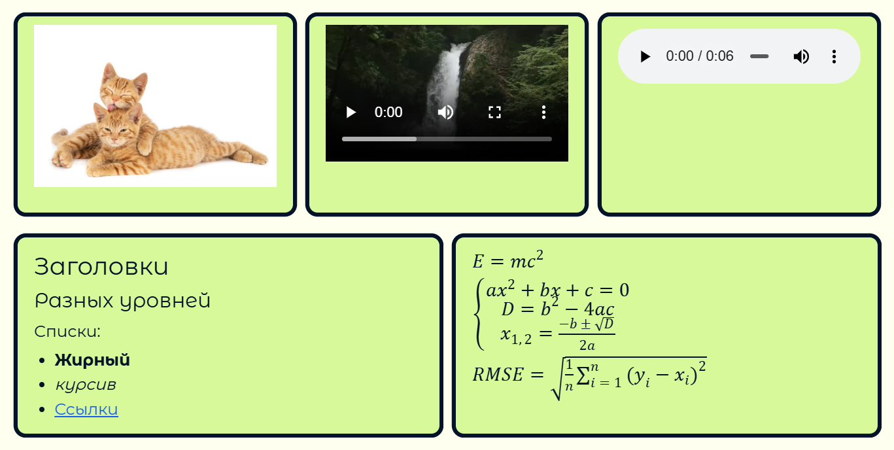
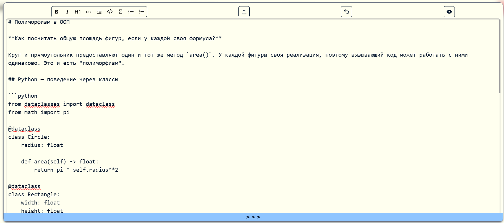
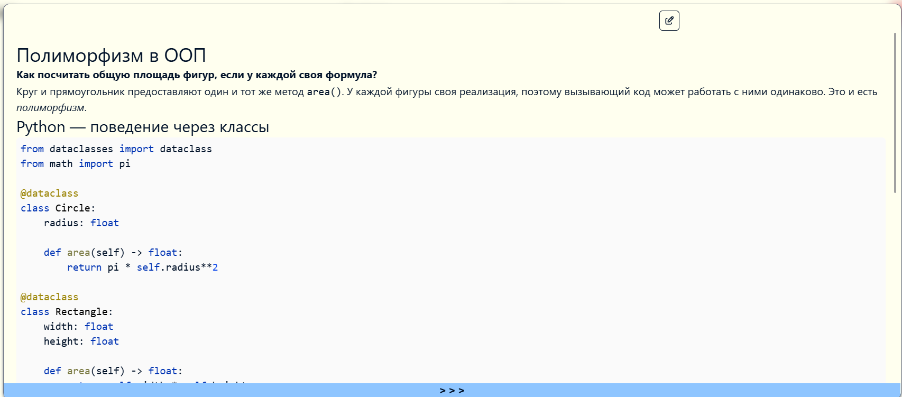
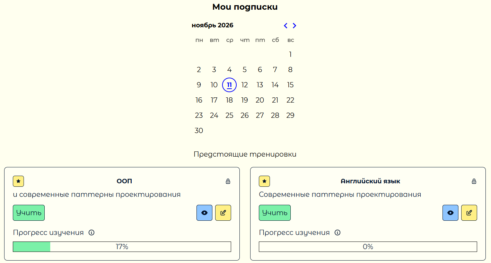
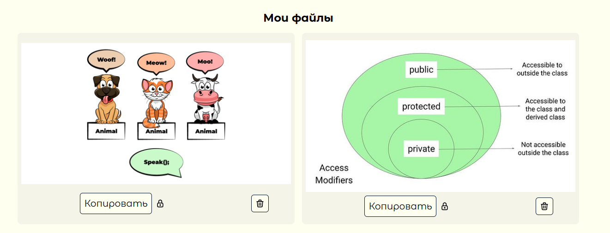

# RecAll


RecAll is a self-hosted flashcard app for spaced repetition. Create cards, organize them into collections and review them when they are due.

## Table of contents
- [Description and features](#description-and-features)
  - [Markdown editor](#markdown-editor)
  - [Review scheduling](#review-scheduling)
  - [File storage](#file-storage)
- [How to use](#how-to-use)
  - [Our site](#our-site)
  - [Self-hosting](#self-hosting)
- [Stack and implementation](#stack-and-implementation)
  - [Frontend](#frontend)
  - [Backend](#backend)
  - [Infrastructure](#infrastructure)
- [Authors](#authors)
  - [Responsibilities](#responsibilities)
    - [Kirill Kozlov](#kirill-kozlov)
    - [Anton Tsoy](#anton-tsoy)

## Description and features

### Markdown editor

Both sides of a card support Markdown, LaTeX formulas, images, audio, video and syntax-highlighted code blocks.



The editor supports keyboard shortcuts, undo, pasting links and dropping media files directly onto a card.

<div style="display: flex; justify-content: space-around; width: 100%">


</div>

### Review scheduling

RecAll uses each learner's review history to tune the [Python FSRS](https://github.com/open-spaced-repetition/py-fsrs) scheduler. The review calendar shows which collections are due on a selected day.



### File storage

RecAll stores uploaded media in your MinIO instance. Attachments become public when a linked card is shared through a public collection.



## How to use

### Our site

*Coming soon.*

### Self-hosting

<details>
<summary>RecAll is the completely self hosted project. Click here to see deployment instruction.</summary>

1. **Prepare the server.** Use a Linux host with Docker Engine and Docker Compose 2.20.0 or later. Point your domain's DNS record to the host and allow incoming TCP connections on ports 80 and 443. The supplied Compose files also publish ports 5432, 8000, 8080, 9000 and 9001. Keep these reachable only from trusted hosts. Run the following commands from the root of a fresh checkout. [Compose requirements](https://docs.docker.com/reference/compose-file/include/)

2. **Create the environment files.**

```sh
cp .env.example .env
cp frontend/.env.example frontend/.env
cp backend/.env.example backend/.env
for template in backend/config/examples/*.env.example; do
  name=$(basename "$template" .example)
  cp "$template" "backend/config/$name"
done
```

3. **Set the deployment values.** Replace the placeholders in all eight files. The examples below use `recall.example.org`. Generate a different secret for each credential, for example with `openssl rand -hex 32`.

| File | Values to set |
| --- | --- |
| `.env` | Set `HOSTNAME=recall.example.org` and `CERTBOT_PATH` to an absolute directory for certificates and ACME challenges. |
| `frontend/.env` | Set `VITE_RECALL_API_HOSTNAME=https://recall.example.org/api` without a trailing slash. Vite embeds this URL at build time. |
| `backend/.env` | Set `POSTGRES_VOLUME_PATH` and `MINIO_VOLUME_PATH` to separate absolute host directories for persistent data. |
| `backend/config/auth.env` | Set a random `SECRET_KEY`. For HTTPS, use `ALGORITHM=HS256`, `ACCESS_TOKEN_KEY=recall_session`, `EXPIRE_HOURS=12`, `HTTPONLY=true`, `SECURE=true` and `SAMESITE=lax`. |
| `backend/config/postgres.env` | Choose the database name, user and password. Keep `POSTGRES_HOST=postgres` and `POSTGRES_HOST_PORT=5432`. |
| `backend/config/minio-server.env` | Set `MINIO_ROOT_USER` and `MINIO_ROOT_PASSWORD` for storage administration. Keep the supplied volume and console options. |
| `backend/config/minio-backend.env` | Set a separate application login and password, a bucket name such as `recall-media` and an upload limit such as `MINIO_MAX_FILE_MB_SIZE=8`. Keep `MINIO_HOSTNAME=minio` and `MINIO_PORT=9000`. |
| `backend/config/train.env` | Set `TRAIN_REOPT_REQUIRED_LOGS_CNT` to the number of new review logs between FSRS parameter updates, for example `1000`. |

Load the domain and paths into the current shell and create their directories on the Docker host.

```sh
set -a
. ./.env
. ./backend/.env
set +a
mkdir -p "$POSTGRES_VOLUME_PATH" "$MINIO_VOLUME_PATH" "$CERTBOT_PATH/www" "$CERTBOT_PATH/conf"
```

1. **Prepare the backend build.** In `Settings.get_api_hosts()`, add the same absolute API URL you set in `frontend/.env`. The backend uses this list to recognize attachments in card Markdown. [Backend settings](./backend/app/core/config.py)

2. **Set up HTTPS.** If you already have a certificate, place the full chain and private key at `$CERTBOT_PATH/conf/live/$HOSTNAME/fullchain.pem` and `privkey.pem` in the same directory. To obtain a Let's Encrypt certificate, free port 80 and run the helper from its own directory, using the variables exported above.

```sh
(cd config/certbot && sh new-cert.sh "$HOSTNAME")
```

6. **Initialize storage before starting the API.** The backend checks for the bucket at startup. Start PostgreSQL and MinIO, then use the setup container's credentials to create the application user and bucket through the MinIO API.

```sh
docker compose config --quiet
docker compose up -d --wait postgres minio
docker compose run --rm minio-setup
```

7. **Start RecAll and verify the deployment.** Starting `nginx` also builds and starts its frontend and backend dependencies. Check that the proxy serves both the homepage and the API schema. Then open `https://<your-domain>/`, register a user and create a card.

```sh
docker compose up -d --build nginx
docker compose ps
curl -fsS --retry 5 --retry-connrefused "https://$HOSTNAME/" -o /dev/null
curl -fsS --retry 5 --retry-connrefused "https://$HOSTNAME/api/openapi.json" -o /dev/null
```

If either check fails, inspect `docker compose logs --tail=100 nginx frontend backend`. Rebuild after changing the frontend API URL or backend configuration. The backend image contains the files in `backend/config/`, including the deployment credentials.

</details>

## Stack and implementation

### Frontend

- `React` and `TypeScript` power the single-page application. `Wouter` handles routing, `Zustand` holds application state and `Jotai` persists editor history.
- `TanStack Query` manages API requests through a TypeScript client generated from the `OpenAPI` schema.
- RecAll's **custom** text editor engine handles Markdown editing. The preview renders Markdown with `markdown-it`, formulas with `KaTeX` and code with `highlight.js`.
- `Vite` builds the production bundle, which `Nginx` serves from the frontend container.

See more in the [frontend README](./frontend/README.md).

### Backend

- `FastAPI` handles authentication, cards, collections and reviews. The training service uses `FSRS` to schedule each learner's next review.
- Repositories use asynchronous `SQLAlchemy` Core queries to store application data in `PostgreSQL`.
- `MinIO` provides S3-compatible storage for card attachments.

See more in the [backend README](./backend/README.md).

### Infrastructure

The root Compose file includes the frontend and backend stacks. Each stack can also run independently using its own Compose file. Nginx terminates TLS and routes `/api/` to FastAPI and `/` to the frontend.

## Authors

[Kirill Kozlov](https://github.com/KozlovKV) and [Anton Tsoy](https://github.com/AntonTsoy) developed RecAll at [Novosibirsk State University](https://www.nsu.ru/n/) as part of their team software development coursework and bachelor's theses.

### Responsibilities

The contributions below cover this monorepo and the original [frontend](https://github.com/RecAll-spaced-repetition/recall-front) and [backend](https://github.com/RecAll-spaced-repetition/recall-back) repositories.

#### Kirill Kozlov

- Implemented `Wouter` routes and `Zustand` state slices for authentication dialogs, card editing and review sessions.
- Built registration and sign-in forms with `React Hook Form` and `Zod` validation.
- Built collection editing, double-sided card previews and the review screen for revealing answers and submitting grades.
- Implemented **Markdown formatting shortcuts** and restored the cursor or text selection after undo.
- **Persisted separate editing histories** for the front and back of each card with `Jotai` and local storage.
- Added **clipboard and drag-and-drop uploads** that insert media links into the card being edited.
- Integrated `KaTeX`, syntax highlighting and audio/video playback into the card renderer.
- Localized the interface in English and Russian with `i18next` and **browser language detection**.
- Integrated the Python `FSRS` scheduler and stored each user's card state, ratings and review times.
- **Refit FSRS** parameters from each user's review history after a configurable number of new reviews.
- Added **API endpoints** for due cards, collection review dates and recall probability estimates.
- Built the review **calendar**, activity **charts**, study streak display and collection progress bars in React.
- Implemented collection subscriptions across the database, FastAPI endpoints and profile UI.
- Integrated async `MinIO` storage with upload type and size checks, streaming downloads and file deletion.
- Linked attachments to cards and propagated collection visibility to linked cards and files.
- Set up **TypeScript client generation** from `OpenAPI` and wrote `React Query` hooks for cards, collections, reviews and statistics.
- Wrote `Vitest` tests for Markdown editor commands, including cursor placement, selected text, links and media.
- Added `Playwright` browser tests for UI components and application startup.
- Migrated the frontend build to `Bun` and replaced `shadcn/ui` dialogs and menus with `Headless UI` components.
- **Combined the frontend and backend Compose stacks**, configured `Nginx` routing and scripted **TLS** certificate issuance and renewal.
- Prototyped `Ollama`-based answer comparison and later removed it from the application.

#### Anton Tsoy

- Built the first `SQLite` prototype for user collections before moving the backend to `PostgreSQL`.
- Designed the user, card, collection and training record tables, including **many-to-many card membership** and cascading deletes.
- Migrated database access to **asynchronous** `SQLAlchemy` Core queries against `PostgreSQL`.
- Implemented `FastAPI` endpoints and `Pydantic` schemas for profiles, cards and collections.
- Implemented registration, sign-in and sign-out with `bcrypt` password hashing and **JWT authentication cookies**.
- Enforced **ownership checks** when editing cards, collections and their links.
- Built the original review workflow for recording grades, calculating repeat intervals and selecting cards due for review.
- Introduced **typed repositories** and **separated database queries** from service logic and HTTP handlers.
- Implemented **Unit of Work transactions** and used Python context variables to isolate connections across concurrent requests.
- Added a shared service decorator to wrap related repository operations in one transaction.
- Scoped collection review queries to each learner's history so one user's grades could not change another's queue.
- Fixed MinIO error handling for bucket checks and object deletion.
- Packaged the backend with `Poetry` and `Docker` and configured service startup dependencies in `Compose`.
- Configured `Uvicorn` worker recycling and container memory limits for the backend.
- Wrote `pytest` coverage for authentication, protected routes, application startup and the user service in the original backend repository.
- Configured `GitHub Actions` in the original backend repository to run `Ruff` and `pytest` on Python 3.11 and 3.12.
- Added **GitHub deployment records** for staging and production after successful CI runs in that repository.
- **Documented** the backend architecture, domain models, environment configuration and API endpoints.
